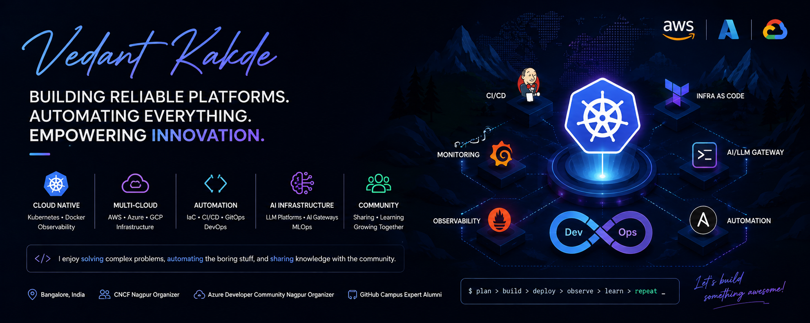

# Hi👋🏻 I'm Vedant

Building reliable platforms, exploring cloud-native technologies, and documenting everything I learn.

I enjoy turning complex infrastructure topics into practical guides and open-source resources for the community.

  

---

## 🚀 Featured Repositories
If one of my repositories helps you, consider giving it a ⭐

### 📘 Kubernetes Internals Explained
A deep dive into how Kubernetes works under the hood—from API requests to scheduling, networking, storage, security, and much more.

➡️ **Repository:** [kubernetes-internals-explained](https://github.com/vedant-kakde/kubernetes-internals-explained)

---

### 🐳 Docker Deep Dive
Everything about Docker—from fundamentals to production best practices, image optimization, networking, security, troubleshooting, and internals.

➡️ **Repository:** [docker-deep-dive](https://github.com/vedant-kakde/docker-deep-dive)

---

### ⭐ Open Source Tools Spotlight
A curated collection of open-source tools that make infrastructure, DevOps, Kubernetes, AI, and platform engineering easier.

➡️ **Repository:** [open-source-tools-spotlight](https://github.com/vedant-kakde/open-source-tools-spotlight)

---

### 🌱 Career Growth, Culture & Leadership
Thoughts, lessons, and experiences on career growth, engineering culture, leadership, mentoring, interviews, and professional development.

➡️ **Repository:** [career-growth-culture-leadership](https://github.com/vedant-kakde/career-growth-culture-leadership)

---

## 📖 Currently Exploring

- AI Infrastructure
- Platform Engineering
- Gateway API
- Kubernetes Internals
- Distributed Systems
- Open Source
- Production Engineering

---

## 🏆 Certifications

✅ LFCS (Linux Foundation Certified System Administrator)

✅ GitHub Foundations

✅ KCNA (Kubernetes and Cloud Native Associate)

✅ CKA (Certified Kubernetes Administrator)

🚀 **Kubestronaut Journey (In Progress)**

- KCNA ✅
- KCSA
- CKA ✅
- CKAD
- CKS

---

## 🤝 Community

I enjoy sharing knowledge through:
- Open-source projects
- Technical write-ups
- Community events
- Mentoring
- Speaking sessions

---

### 💭 Philosophy

> *Learn deeply. Build openly. Share generously.*

